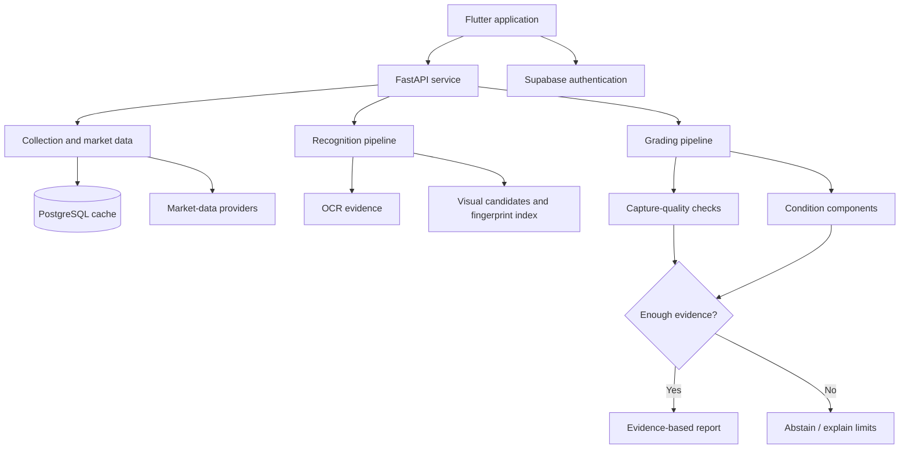

# GradingFy

### Trading card collection, recognition, market data, and evidence-based grading

**Flutter · Dart · Python · FastAPI · PostgreSQL · Supabase**

[Explore the case study](https://aliriodarocha.dev/projects/gradingfy) · [View the portfolio](https://aliriodarocha.dev) · [Contact the developer](mailto:alirio.darocha@outlook.com)

> **Engineering case study · Active development**  
> This public repository documents GradingFy's design and selected authentic user-interface captures. The application, API, scanner, grading engine, data assets, and deployment configuration are maintained in private repositories. This repository is **not** the production source code or a runnable distribution.

## Overview

GradingFy is an end-to-end trading card platform that connects collection management, card identification, market-data retrieval, and structured grading analysis. Its initial focus is Pokémon cards, with an architecture designed to accommodate additional trading card games.

The central engineering challenge is **trustworthy decision-making from imperfect evidence**. A scan can be blurred, a card printing may be unsupported, a provider may be unavailable, or the reference data may be incomplete. In those cases the system should explain uncertainty or abstain rather than manufacture a confident identification or grade.

## Product interface

These are **authentic July 2026 screenshots** of collection features already published in the project portfolio. They do not show the current scanner workflow. Additional card games labeled *Coming Soon* remain inactive in these captures.

| Collection browser | Set progress |
| :---: | :---: |
|  |  |

*The screenshots are product UI examples, not verified user holdings, live market values, or performance measurements.*

## Engineering scope

### Flutter mobile experience

- Collection browsing and set-level completion tracking.
- Capture and card-identification workflows exposed through application/backend contracts.
- Authentication and account-aware flows through Supabase.
- Navigation and application state management with `go_router` and Riverpod.
- UI that can present partial results and failure states without claiming unsupported certainty.

### Recognition pipeline

- OCR and visual candidate retrieval run as parallel evidence channels; OCR is not a single point of failure.
- A server-side visual fingerprint index is loaded under manifest/integrity checks.
- Invalid modes, stale generations, malformed pages, and index/manifest mismatches fail closed rather than silently publishing unreliable matches.
- Cache invalidation, bounded pagination, candidate ranking, and recoverable provider failures are handled as explicit engineering boundaries.
- An unsupported or insufficiently evidenced card may remain unidentified.

### Grading analysis

The backend separates recognition from grading. Dedicated modules evaluate capture quality and multiple card-condition signals, including:

- Centering and geometry.
- Corners and edges.
- Structural and surface evidence.
- Print-quality observations.
- Explanation, prediction, and calibration boundaries.

**A grade is not guaranteed.** When image quality or reference evidence does not support a responsible estimate, the system can withhold a numeric result. Automated grading is an engineering feature under active validation, **not a claim of PSA equivalence or proven production accuracy**.

### Market-data architecture

- PostgreSQL-backed cache for repeated lookups.
- Provider abstraction and fallback logic for market-data sources.
- Reuse of stored missing-card records where appropriate.
- Separation between user-interface state and data-provider implementation.

The public case study does **not** claim a measured percentage speedup or live pricing accuracy.

## Architecture at a glance

*Conceptual illustration of major responsibilities, not a complete deployment diagram or API specification.*

## Testing and quality

A November 20, 2026 engineering audit recorded the following **passing test results**:

| Scope | Passing tests | Context |
| --- | ---: | --- |
| Flutter client | **279** | Current audited local working tree |
| FastAPI/backend | **2,866** | Clean audited API worktree |
| Scanner-focused API cases | **2,154** | Subset of the 2,866 backend tests |
| Grading-related API cases | **395** | Subset of the 2,866 backend tests |

The scanner and grading figures **must not be added** to the overall backend test count. The audit also documented environment/platform-gated skips; the values above are passing counts, not a claim that every possible integration scenario ran. These numbers reflect the specified audited snapshots, not a continuously updated live CI dashboard.

The test strategy emphasizes deterministic synthetic fixtures, failure handling, cache behavior, bounded scoring and retrieval, capture-quality checks, and regression coverage across interface and service boundaries.

**Not claimed:** production recognition accuracy, PSA-grade agreement, measured latency/throughput improvement, active user totals, or live infrastructure availability.

## Design decisions

1. **Fail safely rather than guess:** poor evidence, incomplete fingerprints, and provider outages must not become confident results.
2. **Keep components testable:** mobile presentation, recognition, grading, persistence, and market providers have distinct responsibilities.
3. **Prefer explicit provenance:** test output, capture quality, index manifests, and provider failure modes are identifiable.
4. **Optimize for extensibility:** adding regional data providers or other card games should not require rewriting mobile screens.
5. **Treat deployment and accuracy as separate questions:** a working automated pipeline is not sufficient proof of real-world grading accuracy.

## Development status and roadmap

GradingFy is under active development. Collection UI, scanner, and grading workstreams are not all represented by the same public screenshots. Current priorities include improved real-card evaluation, capture guidance, performance benchmarking, additional collection experiences, and broader TCG/provider coverage. Roadmap ideas are **not promises of released features**.

## Public repository boundaries

To protect users and the project, this repository intentionally excludes:

- Private application and backend source code.
- `.env` files, keys, tokens, and authentication details.
- Customer accounts, collection records, analytics, or private screenshots.
- Proprietary fingerprints, grading fixtures, and unreleased provider integrations.
- Internal audit artifacts or deployment credentials.

For a more detailed engineering narrative and current approved gallery, read the [GradingFy case study](https://aliriodarocha.dev/projects/gradingfy).

---

**Built by [Alirio da Rocha](https://aliriodarocha.dev)** — Software Engineer focused on backend development, reliability, and testable systems.
